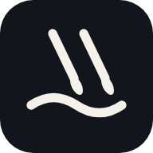
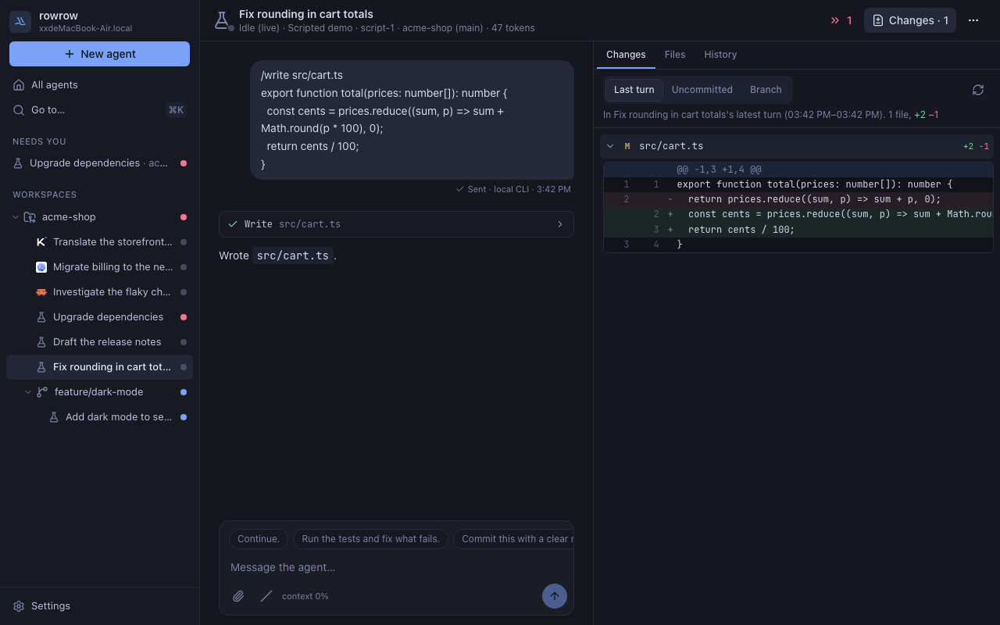
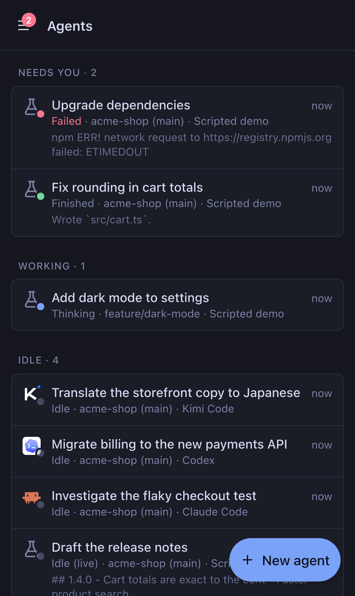
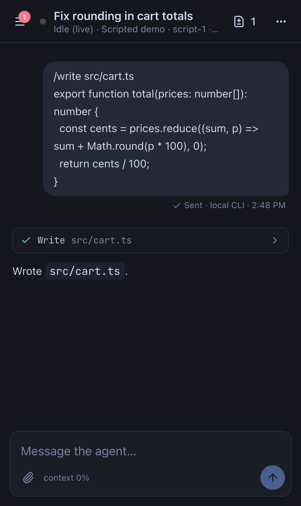

<p align="center"></p>

<h1 align="center">rowrow</h1>

<p align="center">
  Run Claude Code, Codex, Cursor, Antigravity, Grok, Kimi, OpenCode and Pi side by side on your machine,
  and steer them from any browser, including your phone.
</p>

<p align="center">
  <a href="https://www.npmjs.com/package/rowrow"></a>
  <a href="https://github.com/xxchan/rowrow/actions/workflows/ci.yml"></a>
</p>

## Quick start

Needs Node.js 24+, git, and an agent CLI you're signed in to (`claude`, `codex`,
`cursor-agent`, `grok`, `kimi`, `opencode`, `pi`, or Antigravity's `agy_acp_server.par`).

```bash
npx rowrow@latest serve        # http://127.0.0.1:7373; open the sign-in link it prints
```

To keep it running, install it as a service (launchd or systemd; same flags as `serve`):

```bash
npm install -g rowrow
rowrow service install         # again after switching Node versions
```

### A second machine

Agents on a dev box, a Mac mini or a cloud VM, steered from your laptop and phone. On that
machine:

```bash
npx rowrow up
```

It runs rowrow there as a service that only your own networks reach (your LAN and
[Tailscale](https://tailscale.com), never the internet), and prints its addresses, a pairing
code (ABCD-EFGH, once, for 10 minutes) and a QR code. Then, on the device you steer from:
rowrow for Mac → **Add a machine**, pick it, type the code; or open one of the addresses in a
browser and type the code; or scan the QR code with your phone. `rowrow up` again for a new code.
With Tailscale on both, the connection is encrypted and works from anywhere; on a LAN alone it's
plain HTTP, which that network can read.

## What it is

[herdr](https://herdr.dev)-style workspaces (a long-lived server owns your agents, and
every screen answers *who needs me now?*), but with a rich web UI instead of a TUI and
tmux keys. On a phone, use the web app from the home screen or the native iOS app.

It's local first: your phone connects straight to your machine, over your LAN or
Tailscale. There is no relay, account or cloud, so it works where remote-control apps that
go through a vendor's server are not allowed.

<p align="center">
  
</p>
<p align="center">
  
  &nbsp;
  
</p>

## On your phone

`rowrow up` (above) and scan its code, or **Settings → Sign in another device** on a signed-in
browser. For push notifications on iPhone (*Add to Home Screen*), the web app needs HTTPS: with
[Tailscale](https://tailscale.com),

```bash
tailscale serve --bg 7373
rowrow service install --public-url https://<machine>.<tailnet>.ts.net
```

Every request needs a device credential, and anyone signed in can run commands on this
machine: guard your pairing links.

### The iOS app

A native app for what you do on a phone: an inbox sorted by who needs you (swipe to reply
or mark seen), conversations that open at the latest answer with the agent's work folded
behind it, notifications you can reply to from the lock screen, a dictation-first composer,
and reviewing changes line by line. Build it from `ios/` with Xcode, or let CI send it to
TestFlight ([docs/ios.md](docs/ios.md)), then scan the same pairing code. Notifications
need your own APNs key (`rowrow push apns …`); Apple sees only that an agent finished,
never what it said.

## On your Mac

rowrow for Mac (Apple silicon, from the [releases](https://github.com/xxchan/rowrow/releases))
is a window onto the machines your agents run on, and the manager of rowrow on them. Add a
machine: **this Mac** (it installs rowrow and hands it to launchd, like
`rowrow service install`), **one over SSH** (it puts rowrow there and keeps it running, the
way VS Code's Remote-SSH does), or **one on your network or tailnet** (run `npx rowrow up`
there, pick it from the list, type its code). The sidebar's top row switches between them.
Agents keep working when the app is closed; it stays in the menu bar with notifications you
can reply to, and keeps itself and rowrow on its machines up to date, waiting for agents to
finish their turn before rowrow restarts there ([docs/desktop.md](docs/desktop.md)).

## CLI

Everything the UI does, so agents can drive agents too. `rowrow help` for the rest.

```bash
rowrow agents                                      # who needs you first
rowrow agent new ~/code/app "Fix the flaky test" --runtime codex --wait
rowrow agent send <agent> "also update the changelog" --wait
rowrow notify "Deploy failed" "api-7 is crash-looping" --key deploy-7   # from inside an agent: tell you
```

## Status

Early: no compatibility promises before 1.0. Agents run with permission prompts off
([D-022](docs/decisions.md)), so give them repositories you'd give a colleague, ideally in
worktrees.

## More

- [PRINCIPLES.md](PRINCIPLES.md), [architecture](docs/architecture.md),
  [decisions](docs/decisions.md), [roadmap](docs/roadmap.md)
- Contributing: read [AGENTS.md](AGENTS.md), then `pnpm install && pnpm dev`, and
  `pnpm check` before a commit.

Apache-2.0
